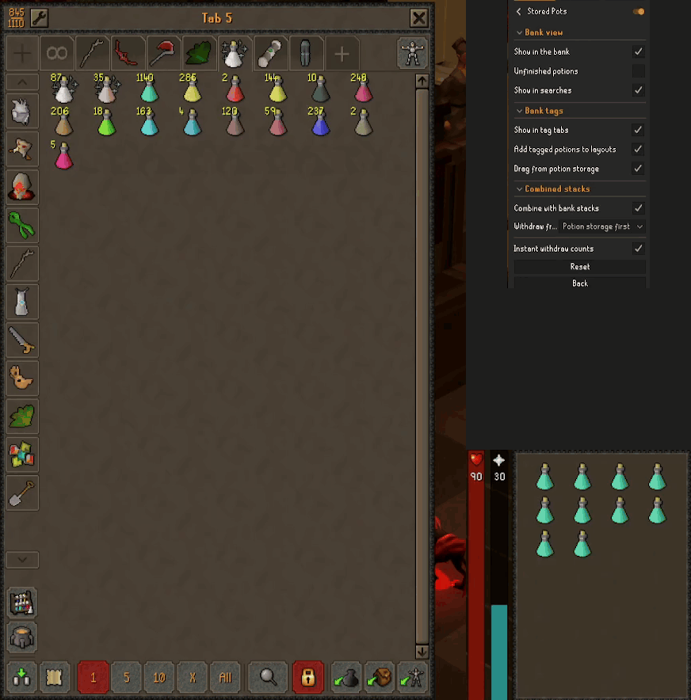
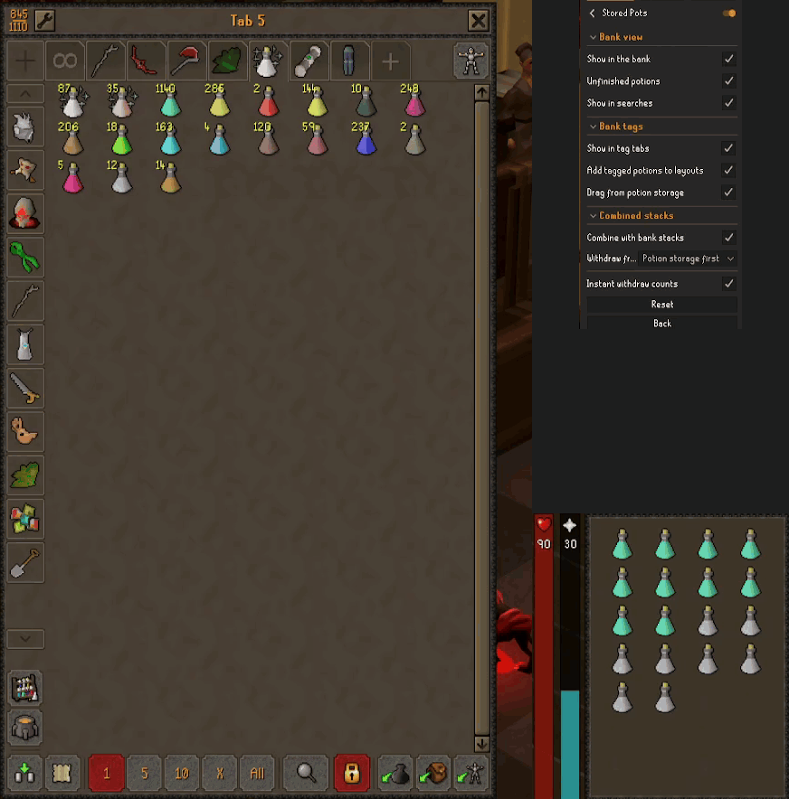
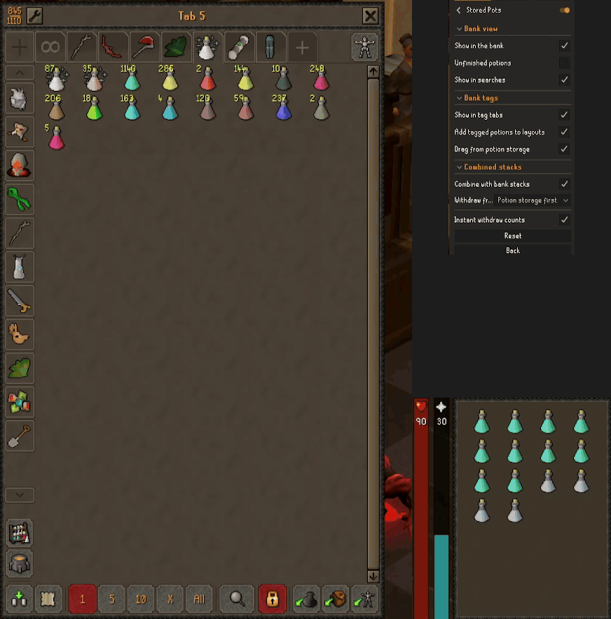
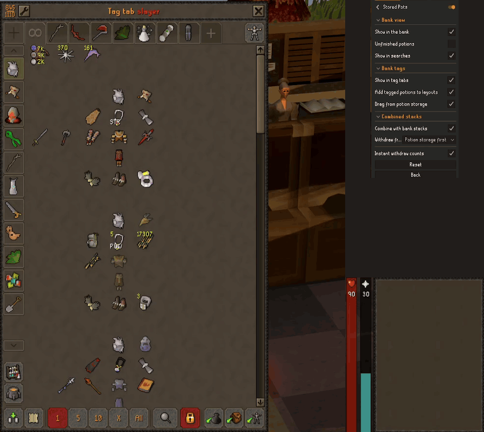
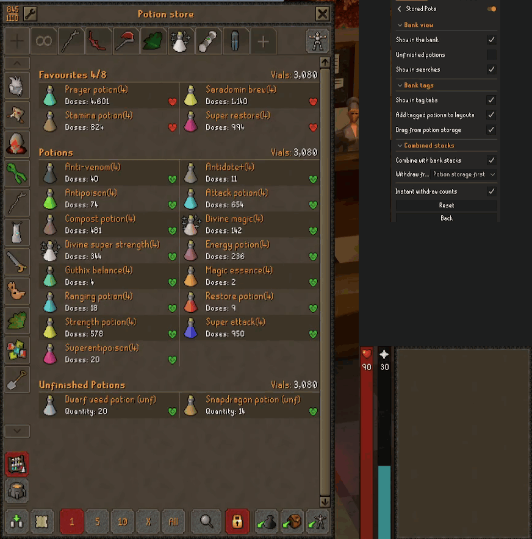

# Potion Storage

A RuneLite plugin that shows the bank's potion storage as ordinary bank items. Stored potions appear in
"View all items" and the numbered tabs, in bank searches and in tag tabs. You can drag them around and swap
them with other items, and withdraw from them like any other stack. They take up no bank space: every click
still withdraws from potion storage.

## In action

**Stored potions in a bank tab**, with **Show in the bank** turned off and back on:



**Withdrawing** straight from the bank tab, as from any bank stack:



**Depositing** potions back, with the game's *Always deposit to potion storage* setting:



**Tag tabs**: dragging a potion from potion storage onto a tag tab, and its menu in a laid-out tab:



**Searches**: stored potions listed under the tab each is in, then moved about in their tab:



## What it does

- **In the bank and its tabs.** Stored potions start at the end of the untabbed section. Drag one anywhere,
  including into a numbered tab or onto another tab's button. Swap and insert mode both work, between stored
  potions and real items alike. The order is saved per account, and items you rearrange where the plugin
  can't see it (in a search, with the plugin off, on another device) keep their new places.
- **Withdrawing.** Every withdraw option works, including the Doses submenu. With **Instant withdraw counts**
  on (the default), the count goes down as soon as you click, instead of when the server confirms a moment
  later.
- **Searches.** A bank search lists the stored potions whose names match, each under the tab it is in, and
  `tag:` searches match their tags. Drag them about in a search as the game lets you drag items there: swap
  swaps, and insert puts the potion just in front of the stack you drop it on. (This needs **Show in the
  bank**: with it off, a search lists stored potions in the first section, in no order of their own.)
- **Tag tabs.** Tag a stored potion the usual way (Edit-tags, or drag it onto a tag tab). A tag tab without a
  layout lists it after the bank items. A laid-out tag tab gets a place for it, the same way the Bank Tags
  plugin adds a newly tagged bank item. The Bank Tags plugin then draws it from potion storage itself.
- **In potion storage itself.** Right-click a potion for **Edit-tags**. Hold a potion's icon for a moment and
  drag it onto a tag tab to tag it (hold Shift as you drop to tag every dose). A quick click still opens the
  doses menu.
- **Combined stacks.** When the bank holds the same potion and dose as potion storage, as a stack or a
  placeholder, the two show as one stack with both counts. By default a withdrawal takes from potion storage
  first, so a single potion kept in the bank (as a tab's icon, say) stays put; it can be set to take from the
  bank first instead. A placeholder always withdraws from potion storage. Stacks are only combined where
  stored potions are shown: with **Show in the bank** off, the bank's own stacks show the bank's count alone
  (and likewise for searches and tag tabs).

## Limits

- A potion from storage can't start a new bank tab. The game only creates a tab around a real item, so put an
  item (a placeholder will do) in the new tab first, then drag potions into it.
- Dragging a stored potion onto a real item in another tab inserts it there, even in swap mode: a swap would
  put the real item in a tab the game hasn't moved it to.
- Empty vials in potion storage aren't shown.
- Withdraw-X and the Doses submenu don't count down early, because the plugin doesn't know how many they take.
- Dragging from potion storage is off while the Potion Storage Customizer plugin is on, since it rebuilds
  potion storage's rows itself.

## How it works

Every bank slot past your last item already exists as a spare item widget, and a stored potion is drawn on
one of those. When one is clicked, the click is pointed at that potion's own button in the potion store. This
is the same redirection the Bank Tags plugin uses for stored potions in laid-out tag tabs, so the game gets
exactly the click a player makes inside the potion store. Drags that only involve stored potions never leave
your client. A real item dropped on a stored potion in another tab is handed to the game as a drop on that
tab's button.

## Settings

| Setting | Default | |
|---|---|---|
| **Bank view**: Show in the bank | on | Stored potions among the bank's own items |
| **Bank view**: Unfinished potions | on | Stored unfinished potions in the bank, in searches and in tag tabs |
| **Bank view**: Show in searches | on | Matching stored potions in bank searches, under the tab each is in |
| **Bank tags**: Show in tag tabs | on | A tag's stored potions in its tag tab, for tag tabs without a layout |
| **Bank tags**: Add tagged potions to layouts | on | Give a tagged stored potion a place in a laid-out tag tab |
| **Bank tags**: Drag from potion storage | on | Drag a potion's icon in potion storage onto a tag tab to tag it |
| **Combined stacks**: Combine with bank stacks | on | One stack for a potion both the bank and potion storage hold, at the same dose |
| **Combined stacks**: Withdraw from | Potion storage first | Which a combined stack withdraws from first |
| Instant withdraw counts | on | Count a withdrawal off the stack as soon as it is clicked |

RuneLite's settings panel can't hide one setting depending on another, so each sub-option sits in a section
with its parent and says in its description which setting it depends on.

## Development

```
./gradlew test            # unit tests
./gradlew shadowJar       # build/libs/potion-storage-1.0.0-all.jar
java -ea -jar build/libs/potion-storage-1.0.0-all.jar   # RuneLite with the plugin loaded
```
