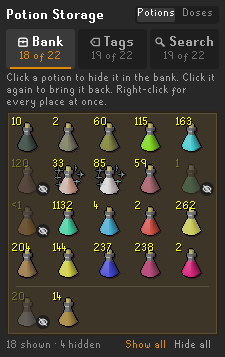

# Potion Storage

A RuneLite plugin that shows the bank's potion storage as ordinary bank items. Stored potions appear in
"View all items" and the numbered tabs, in bank searches and in tag tabs. You can drag them around and swap
them with other items, and withdraw from them like any other stack. They take up no bank space: every click
still withdraws from potion storage. A sidebar panel chooses, potion by potion, where each one is shown.

## In action

**Stored potions in a bank tab**, with **Show in the bank** turned off and back on:


**Withdrawing** straight from the bank tab, as from any bank stack:


**Depositing** potions back, with the game's *Always deposit to potion storage* setting:


**Tag tabs**: dragging a potion from potion storage onto a tag tab, and its menu in a laid-out tab:


**Searches**: stored potions listed under the tab each is in, then moved about in their tab:


**The sidebar panel**: every stored potion, and where each is shown:



## What it does

- **In the bank and its tabs.** Drag a stored potion anywhere, including into a numbered tab or onto another
  tab's button. Swap and insert mode both work, between stored potions and real items alike. The order is
  saved per account, and items you rearrange where the plugin can't see it (in a search, with the plugin off,
  on another device) keep their new places.
- **Depositing.** A potion you deposit into potion storage goes where the game puts a deposited item: at the
  end of the numbered tab you have open, or of the untabbed section in "View all items". A potion that is
  already showing stays where it is.
- **Placeholders.** Take the last of a stored potion while the bank's *Always set placeholders* is on, and a
  placeholder stays in its place, drawn the way the game draws its own. Deposit the potion again and it fills
  the placeholder. Right-click a placeholder to **Release** it. The bank menu's **Release all placeholders**
  counts and releases these placeholders along with the bank's own. A stored potion that runs out without a
  placeholder gives up its place, as a bank item does.
- **Withdrawing.** Every withdraw option works, including the Doses submenu. With **Instant withdraw counts**
  on (the default), the count goes down as soon as you click, instead of when the server confirms a moment
  later.
- **Searches.** A bank search lists the stored potions whose names match, each under the tab it is in, and
  `tag:` searches match their tags. Drag them about in a search as the game lets you drag items there: swap
  swaps, and insert puts the potion just in front of the stack you drop it on. (This needs **Show in the
  bank**: with it off, a search lists stored potions in the first section, in no order of their own.)
- **Tag tabs.** Tag a stored potion the usual way (Edit-tags, or drag it onto a tag tab). A tag tab without a
  layout lists it after the bank items. A laid-out tag tab gets a place for it, the same way the Bank Tags
  plugin adds a newly tagged bank item. The Bank Tags plugin then draws it from potion storage itself.
- **In potion storage itself.** Right-click a potion for **Edit-tags**. Hold a potion's icon for a moment and
  drag it onto a tag tab to tag it (hold Shift as you drop to tag every dose). A quick click still opens the
  doses menu.
- **Combined stacks.** When the bank holds the same potion and dose as potion storage, as a stack or a
  placeholder, the two show as one stack with both counts. By default a withdrawal takes from potion storage
  first, so a single potion kept in the bank (as a tab's icon, say) stays put; it can be set to take from the
  bank first instead. A placeholder always withdraws from potion storage. Stacks are only combined where
  stored potions are shown: with **Show in the bank** off, the bank's own stacks show the bank's count alone
  (and likewise for searches and tag tabs).
- **The sidebar panel.** A tab each for the bank, tag tabs and searches, and under it every potion you have
  stored, laid out like the bank. Click a potion to hide it in that tab's place, or click it again to bring
  it back; right-click it to set all three places at once. Counts are in full potions or in doses, with the
  other on hover. The panel only lists potions you have some of.
- **Deposit warnings.** If the bank's *Always deposit to potion storage* is off, potions you deposit go into
  the bank, not potion storage. The plugin says so in the chat the first time you open the bank each login,
  and again whenever a potion is deposited into the bank, naming it. The sidebar panel shows the same
  warning.
- **Hiding the potion storage button.** Optionally, hide the potion storage button at the foot of the bank's
  tag tabs. Stored potions are still shown, withdrawn and (with *Always deposit to potion storage* on)
  deposited as usual.

## Limits

- A potion from storage can't start a new bank tab. The game only creates a tab around a real item, so put an
  item (a placeholder will do) in the new tab first, then drag potions into it.
- Dragging a stored potion onto a real item in another tab inserts it there, even in swap mode: a swap would
  put the real item in a tab the game hasn't moved it to.
- Empty vials in potion storage aren't shown.
- Withdraw-X and the Doses submenu don't count down early, because the plugin doesn't know how many they take.
- Dragging from potion storage is off while the Potion Storage Customizer plugin is on, since it rebuilds
  potion storage's rows itself.
- The plugin's placeholders have no Examine option: the game sends an item's examine text only for a real
  bank slot.
- The game opens its *Release all placeholders?* confirmation only when the bank has placeholders of its own.
  With only the plugin's to release, the plugin shows its own copy of that confirmation, which releases only
  the plugin's placeholders and sends nothing to the game.

## How it works

Every bank slot past your last item already exists as a spare item widget, and a stored potion is drawn on
one of those. When one is clicked, the click is pointed at that potion's own button in the potion store. This
is the same redirection the Bank Tags plugin uses for stored potions in laid-out tag tabs, so the game gets
exactly the click a player makes inside the potion store. Drags that only involve stored potions never leave
your client. A real item dropped on a stored potion in another tab is handed to the game as a drop on that
tab's button. The plugin's placeholders exist only in your client: nothing about them is sent to the game.

## Settings

| Setting | Default | |
|---|---|---|
| **Bank view**: Show in the bank | on | Stored potions among the bank's own items |
| **Bank view**: Unfinished potions | on | Stored unfinished potions in the bank, in searches and in tag tabs |
| **Bank view**: Show in searches | on | Matching stored potions in bank searches, under the tab each is in |
| **Bank view**: Hide potion storage button | off | Hide the potion storage button at the foot of the bank's tag tabs |
| **Bank view**: Placeholders | on | Leave a placeholder for a stored potion you take the last of, while the bank's *Always set placeholders* is on |
| **Bank tags**: Show in tag tabs | on | A tag's stored potions in its tag tab, for tag tabs without a layout |
| **Bank tags**: Add tagged potions to layouts | on | Give a tagged stored potion a place in a laid-out tag tab |
| **Bank tags**: Drag from potion storage | on | Drag a potion's icon in potion storage onto a tag tab to tag it |
| **Combined stacks**: Combine with bank stacks | on | One stack for a potion both the bank and potion storage hold, at the same dose |
| **Combined stacks**: Withdraw from | Potion storage first | Which a combined stack withdraws from first |
| Instant withdraw counts | on | Count a withdrawal off the stack as soon as it is clicked |
| Warn when deposits skip storage | on | Say so in the chat when *Always deposit to potion storage* is off |
| Sidebar panel | on | The sidebar button and panel for choosing where each potion is shown |
| Sidebar counts | Full potions | Count potions in the sidebar panel in full potions or in doses |

Which potions the sidebar panel hides where is kept with the other settings, so the plugin's **Reset** clears
it too. RuneLite's settings panel can't hide one setting depending on another, so each sub-option sits in a
section with its parent and says in its description which setting it depends on.

## Development

```
./gradlew test            # unit tests
./gradlew shadowJar       # build/libs/potion-storage-1.0.0-all.jar
java -ea -jar build/libs/potion-storage-1.0.0-all.jar   # RuneLite with the plugin loaded
```
